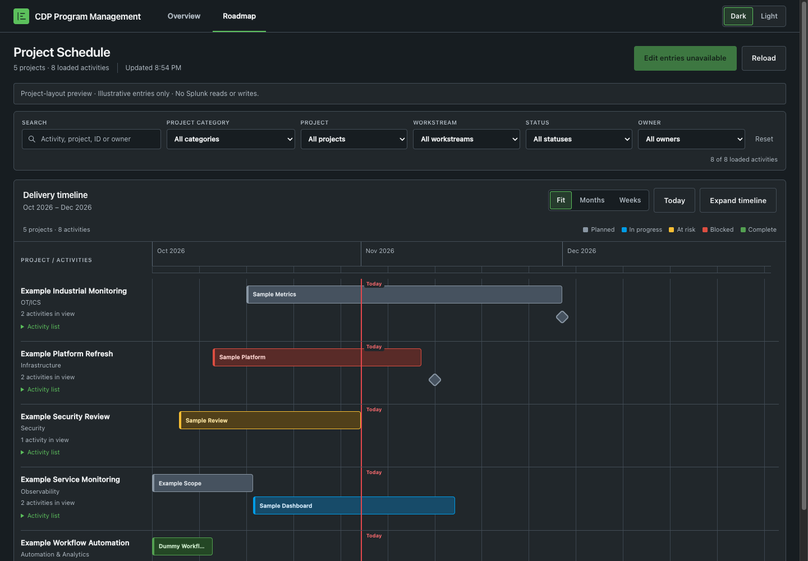

# CDP Program Management

Version **0.7.1** is a CSV-backed project planning app for Splunk Enterprise. The stable app ID is `cdp_roadmap`. It provides an Overview register, project timeline, shared filters, validation feedback and a Dashboard Studio fallback.



[Light theme](docs/screenshots/roadmap-light.png) · [Mobile viewport](docs/screenshots/roadmap-mobile.png)

## Features

- Separate **Project Category**, project, workstream, status and owner filters, plus literal case-insensitive search.
- Categories: **Observability**, **Security**, **Infrastructure**, **Automation & Analytics**, **OT/ICS**. All five choices remain available even when empty.
- Compact layout, Fit / Months / Weeks scales, a Today control, project lanes and parallel activity tracks.
- Category labels in the register, timeline and read-only details; legacy missing categories display **Uncategorized**.
- One bounded `inputlookup max=1001` read on load/Reload. Filtering, tabs and timeline scales do not dispatch new searches.
- Dark/light themes, keyboard-friendly controls, milestone points and informational dependencies.
- Optional Lookup Editor discovery: unavailable editing does not block viewing.
- No KV Store, custom Python handler, native write endpoint, external API or CDN.

**Only dummy data is included.** The eight `DEMO-*` rows use fictional Example projects and Example Owner labels. They demonstrate all five categories/statuses and are not an operational roadmap. No live CSV, project plan, deployment receipt or environment-specific automation is published.

## Compatibility

Targets Splunk Enterprise 10.x with JavaScript, Classic Simple XML 1.1 and locally bundled React. The Studio fallback uses schema version 2. The bundle targets Chrome 100+, Firefox 100+ and Safari 15.4+; this is a compilation target, not proof of every browser/platform combination.

Runtime validation has been performed on a standalone Enterprise 10.6 environment. Separate 10.4, SHC, non-admin and Splunk Cloud acceptance/certification are not claimed. Validate the intended target and installed Lookup Editor version/capabilities before production use.

## Install or upgrade

Build the current package from source, or use an explicitly published release asset for the desired version. Do not assume an older release asset is version 0.7.1.

1. Back up the existing app, live lookup, local configuration and ACLs.
2. Inspect `build/cdp_roadmap-0.7.1.tgz`, then install through the topology's supported process.
3. **Preserve live CSV data on upgrades; never overwrite it with dummy seed rows.** Review destination local overrides and packaged default ACL changes.
4. Activate app/view discovery using the supported operating procedure; approve any required restart separately.
5. Verify the effective version, app-scoped lookup, permissions and `/en-US/app/cdp_roadmap/roadmap`.

For SHC, use the deployer and review `[shclustering] deployer_lookups_push_mode = always_preserve`; verify supported lookup-save replication across members. This setting is not a substitute for deployment-specific review.

## Editing and access

Select **Edit entries**, save the app-shared CSV in Lookup Editor, return and select **Reload**. Missing/inaccessible Lookup Editor disables editing without blocking reads. The runtime itself never writes data.

Packaged metadata allows all-role app/view reads and lookup reads/writes, with admin-only definition writes and app-local sharing. This is intentionally broad: review it for least privilege before sharing. Effective ACL overrides, app access and Lookup Editor capabilities still apply; a wildcard ACL does not grant every required capability.

When adding a CSV column through Lookup Editor, create/name the column before importing: some versions ignore extra import columns. Review the entire buffer and any trailing blank row before saving, keep a backup, and verify the stored data afterward.

See [Lookup schema](docs/lookup-schema.md) and [Administrator guide](docs/administrator-guide.md).

## Build and test

Requirements: Python 3.9+, Node.js 20+ and npm.

```sh
npm ci --ignore-scripts
npm test
npm run build
```

`tools/build_release.py` creates a deterministic archive and `build/manifest.json`. Only `default/`, `metadata/`, `lookups/` and `appserver/` ship. Tests verify source/package hashes, synthetic-only seed data, neutral archive ownership and retained library license notices. On macOS with Google Chrome, `python3 tools/browser_smoke.py` additionally exercises the exact release bundle with isolated synthetic SplunkJS responses.

AppInspect and target-instance checks remain release gates. Local tests are not Splunk Cloud certification.

## Constraints

- Maximum 1,000 displayed activities; a 1,001st row detects overflow.
- Dates are calendar dates; bar end dates are exclusive and equal start/end dates create points.
- Dependencies do not enforce or recalculate schedules.
- All activities in one named project must share one category. Unsupported/conflicting values remain inspectable in Overview but are omitted from the timeline.
- The Studio fallback does not reproduce every React interaction.
- Personal app-author metadata is omitted; required third-party notices remain. Removing author fields does not anonymize CSV text or instance audit/ownership records.

## Documentation

[Architecture](docs/architecture.md) · [Lookup schema](docs/lookup-schema.md) · [Administrator guide](docs/administrator-guide.md) · [Release process](docs/release-process.md) · [Security/privacy](docs/security-privacy.md) · [Contributing](CONTRIBUTING.md) · [Security policy](SECURITY.md) · [Changelog](CHANGELOG.md)

## License status

No license is granted for the app's original code at this time. Public visibility is not a license grant; rights remain reserved until the owner adds a license. Third-party components retain their own required license notices. See `CONTRIBUTING.md` before submitting changes.
